# JDDUG Tokyo 開催レポート
Japan Datadog User Group (JDDUG) Tokyo を開催しました！

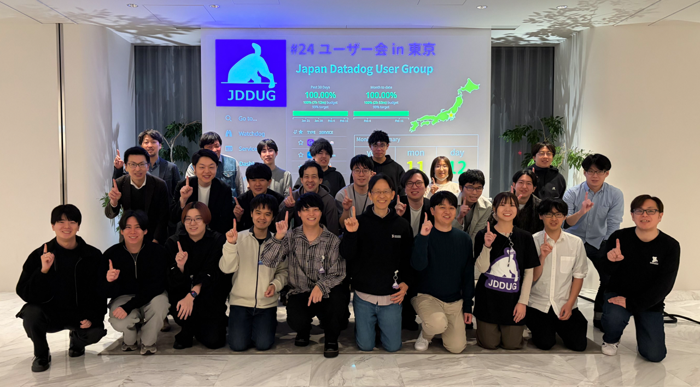

_ビズリーチ 渋谷拠点 での開催_

2026年11月12日、第24会JDDUGは東京で開催しました。
今回はオンライン併設なしの会場参加限定のユーザ会です。会場は渋谷駅から徒歩わずか3分の渋谷アクシュ17階「株式会社ビズリーチ 渋谷拠点」です。とても綺麗で広い空間が素敵でした。Datadogユーザーによる実践的な事例共有が行われ、ガバナンス、セキュリティ、自動化など、従来型IT監視の領域を超えた幅広いテーマが取り上げられました。

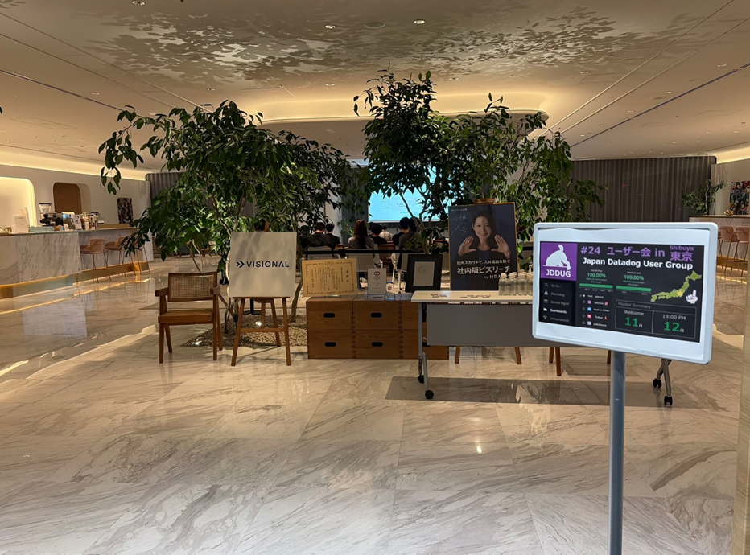

会場をご提供いただいた株式会社ビズリーチ様、ありがとうございました！

<!-- TODO: 当日の会場の雰囲気・感想を追記 -->

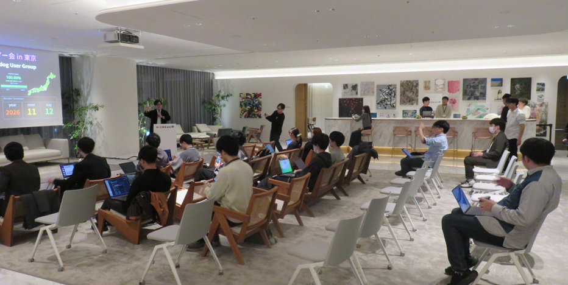

# 発表/LT

今回の発表/LTは計7本です。

- 発表1. Datadogの権限統制（元吉 規之｜株式会社ビズリーチ）
- 発表2. Datadog AAP に攻撃を見張ってもらうという選択（徳富 博｜株式会社タイミー ）
- 発表3. Datadog IDPで広げる開発者セルフサービス（森祐太朗｜ウェルスナビ株式会社）
- LT1. CronJob の失敗通知を作り直した話（柳 敬史）
- LT2. JDDUGオンライン支部始動！（伊藤 佳代｜総合電機メーカー）
- LT3. Datadog Journey Monitoring ってどんな機能？（萩野 たいじ｜Datadog Technical Advocacy Team）
- LT4. Agent無しでここまで出来る！DBモニタリング（鹿野 市郎｜総合電機メーカー, Datadog Ambassador）

<!-- TODO: 資料URLがあれば各セッションに追記 -->

## 司会進行

昨年に続き、今年の司会も 今村 光希（株式会社Goals）さん。ユーザー会を大いに盛り上げていただきました！

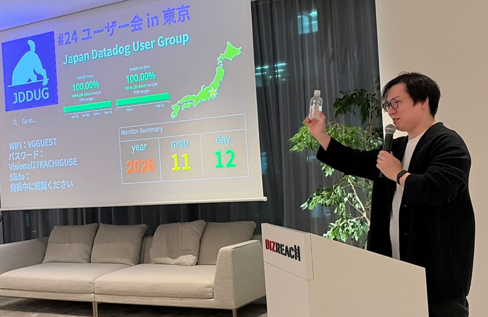

_今村 光希さんの司会_

## 発表1. Datadogの権限統制

元吉 規之（株式会社ビズリーチ）

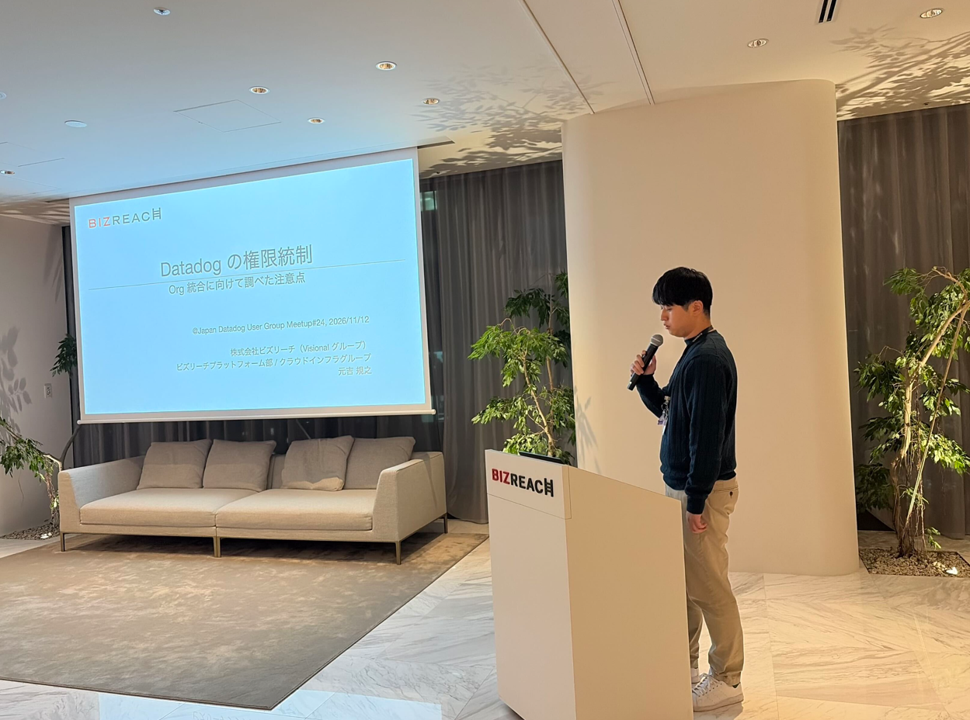

_元吉 規之さんの発表_

### 背景
株式会社ビズリーチでは、複数のDatadog Orgを運用していますが、運用効率化とガバナンス強化を目的としてOrg統合を進めています。
Org統合によってサービスや環境ごとに分かれていたデータやアセットが一箇所へ集約されるため、誰がデータを閲覧できるか / 誰が設定を変更できるか / 誰が責任を持つか を改めて整理する必要があります。

発表では Datadog の Role, Team, GAC（General Access Control）, DAC（Data Access Control） の使い分けや、実際に権限設計を進める上で遭遇した課題について共有されました。

### 課題
複数Orgを統合すると、従来の「環境単位で分離されていたことによる安全性」が失われます。
その結果、他チームのダッシュボードを誤編集する / 機密ログにアクセスできてしまう / 責任者が不明になる などの課題が発生します。

### 発表の面白い点
- Role、Team、GAC、DAC を一つの権限モデルとして整理
- Workload Identity Federation導入時に発生した権限不足の実例を紹介
- 「ダッシュボードを編集できること」と「ログを閲覧できること」を別問題として整理
- Org統合の前にタグ設計やTeam設計を整備する重要性を解説

## 発表2. Datadog AAP に攻撃を見張ってもらうという選択
徳富 博（株式会社タイミー）

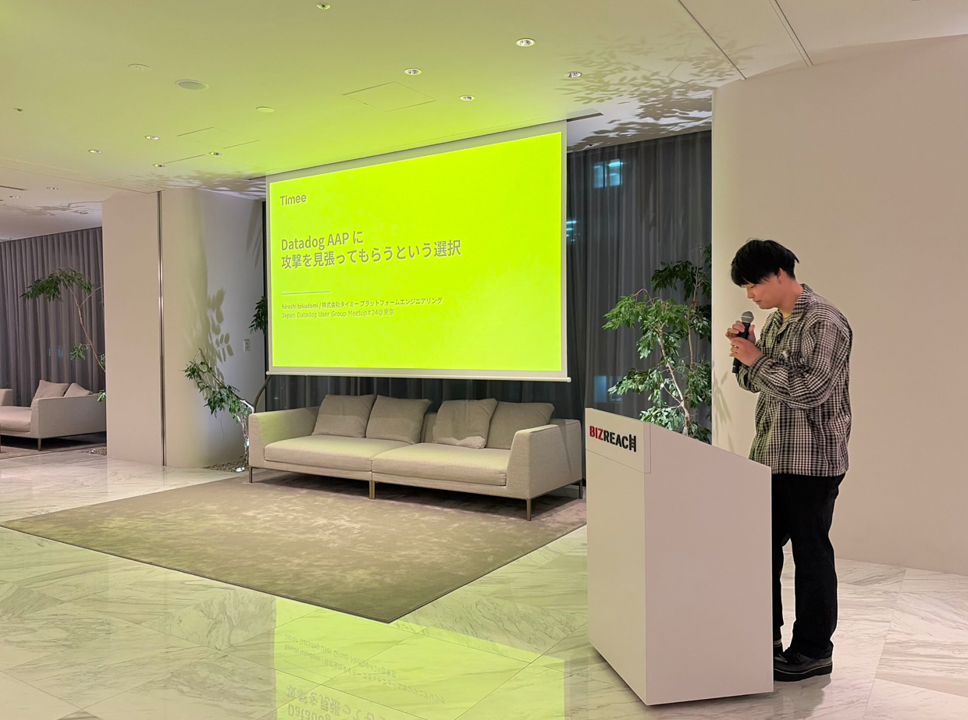

_徳富 博さんの発表_

### 背景
本番環境へのセキュリティ攻撃は平日・休日を問わず発生します。
従来は、「攻撃を検知 → 調査 → AWS WAFへ登録 → 一定時間後に解除」という作業を人手で行っていました。
本発表ではDatadog App and API Protection（AAP）を活用し、攻撃者を一定期間自動的にブロックする仕組みを紹介しました。

### 課題
セキュリティ運用では、夜間・休日対応 / 調査コスト / IPブロック運用 が継続的な負担となります。攻撃検知後の一次対応を自動化できないかという課題がありました。

### 発表の面白い点
- 攻撃パターンを集計して自動ブロック
- ユーザーID単位での制御も可能
- RASPによる「攻撃が成立しそうか」を利用した判定
- AWS WAFとの補完関係による多層防御の実践例

## 発表3. Datadog IDPで広げる開発者セルフサービス
森 祐太朗（ウェルスナビ株式会社）

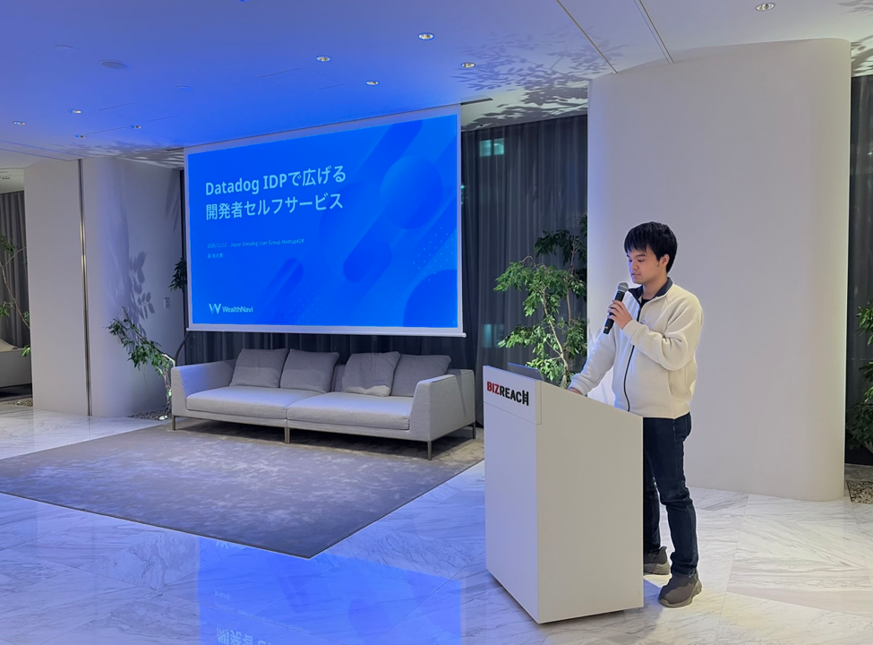

_森 祐太朗さんの発表_

### 背景
開発者プラットフォームの目的の一つは、統制を維持しながら開発者が自律的に作業できる環境を実現することです。
ウェルスナビでは、従来SREが担当していた権限変更作業をセルフサービス化するため、Datadog IDPとWorkflow Automationを活用した仕組みを構築しました。特に印象的だったのは、APIもCLIも提供されていない既存システムを対象としていた点です。

### 課題
ここでの課題は、SREへの依頼増加 / 本番作業申請の増加 / 権限変更作業の運用負荷 です。一方で金融サービスとして統制も維持する必要がありました。

### 発表の面白い点
- Datadog Formを申請窓口として利用
- Workflow Automationで承認プロセスを実装
- Synthetic Browser TestでGUI操作を自動化
- APIやCLIを持たないシステムでもセルフサービス化を実現

<a href="https://www.docswell.com/s/WN_Tech-PR/5E13X1-2026-11-12">Datadog IDPで広げる開発者セルフサービス by @WN_Tech-PR</a>

## LT1. CronJobの失敗通知を作り直した話
柳 敬史（やなぎ たかふみ）

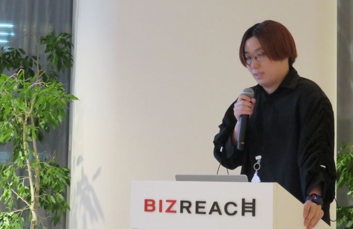

_柳 敬史さんの発表_

### 背景/課題
CronJobの失敗は、起動失敗 / 実行失敗 / 次回実行までに終了しない など複数パターンが存在し、監視が複雑になるという課題がありました。

### 発表の面白い点
失敗状態を単一メトリクスへ集約し、Datadog Monitorで統一的に監視する仕組みを紹介。
監視ロジックをシンプルにしながら、運用品質向上を実現した実践事例でした。

## LT2. JDDUGオンライン支部始動！

伊藤 佳代（総合電機メーカーデジタル領域） 

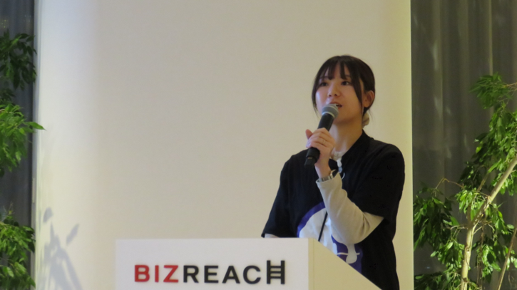

_伊藤 佳代さんの発表_

### 背景/課題
Datadog初心者向けの学習コミュニティが不足しているという課題に対し、オンライン支部が立ち上がりました。

### 発表の面白い点
実際の勉強会で発生した Agent設定 / Log設定 / APM設定 / RUM設定 のつまずきポイントが共有されました。
特に Log設定における Start Position パラメータやAPMサンプリング設定など、実務で遭遇しやすい課題の紹介が印象的でした。

<iframe class="speakerdeck-iframe" frameborder="0" src="https://speakerdeck.com/player/1f9c1431477e4ea3a3cf67b779387777" title="JDDUGオンライン支部始動！" allowfullscreen="true" allow="web-share" style="border: 0px; background: padding-box padding-box rgba(0, 0, 0, 0.1); margin: 0px; padding: 0px; border-radius: 6px; box-shadow: rgba(0, 0, 0, 0.2) 0px 5px 40px; width: 100%; height: auto; aspect-ratio: 560 / 315;" data-ratio="1.7777777777777777"></iframe>

## LT3. Datadog Journey Monitoringってどんな機能？

萩野 たいじ（Datadog Technical Advocacy Team）

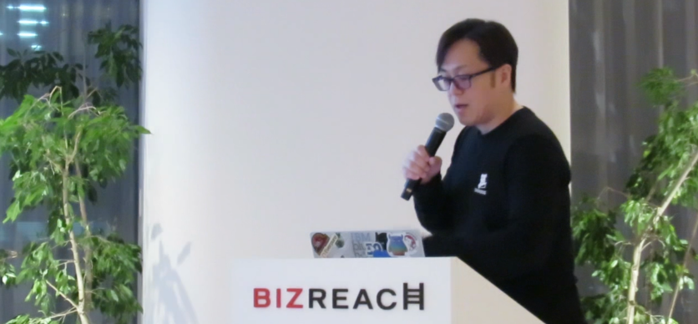

_萩野 たいじさんの発表_

### 背景/課題
従来の監視はシステムやインフラ視点になりがちです。
しかしユーザーにとって重要なのは、「サービスが正常か」ではなく、「やりたいことを達成できたか」です。

### 発表の面白い点
Journey Monitoringを利用することで、ユーザー体験を中心とした監視を実現できます。また、RUM / Synthetics / Product Analytics の既存機能から利用でき、追加SKUが不要である点も紹介されました。

## LT4. Agent無しでここまで出来る！DBモニタリング

鹿野 市郎（電機メーカー勤務 兼 副業ITサービス）

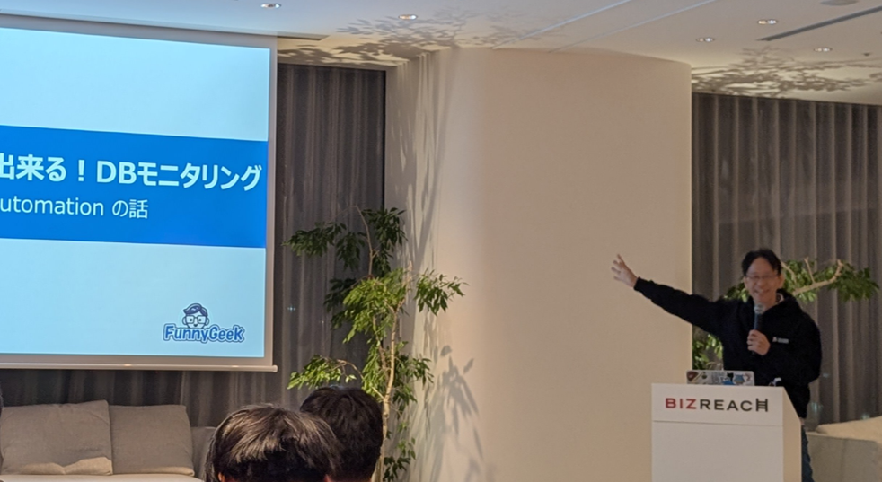

_鹿野 市郎さんの発表_

### 背景/課題
監視対象は、オンプレミス閉域網内のサーバー / Agent導入不可 / 外部通信不可 という厳しい環境でした。
利用できる手段は「メール通知のみ」という状況です。

### 発表の面白い点
メール通知をそのまま監視対象と捉え、Event Management / Workflow Automation / Log Management / Dashboard / Monitor を組み合わせてDBロック監視を実現。
Agentが導入できない環境でもDatadogを活用できることを示したユニークな事例でした。

<iframe class="speakerdeck-iframe" frameborder="0" src="https://speakerdeck.com/player/dd403e40a4a34c26b66c955ab2de2559" title="Agent無しで、ここまで出来る！DBモニタリング（主に Workflow Automation の話）" allowfullscreen="true" allow="web-share" style="border: 0px; background: padding-box padding-box rgba(0, 0, 0, 0.1); margin: 0px; padding: 0px; border-radius: 6px; box-shadow: rgba(0, 0, 0, 0.2) 0px 5px 40px; width: 100%; height: auto; aspect-ratio: 560 / 315;" data-ratio="1.7777777777777777"></iframe>

## 終わりに

セッション終了後は懇親会が開催されました。
登壇者にはスピーカーバッジが配布され、参加者が発表者に直接質問できる場となりました。
技術的な議論だけでなく、Datadogユーザーの会社での運用の実体験などもリアルな情報交換が行われました。

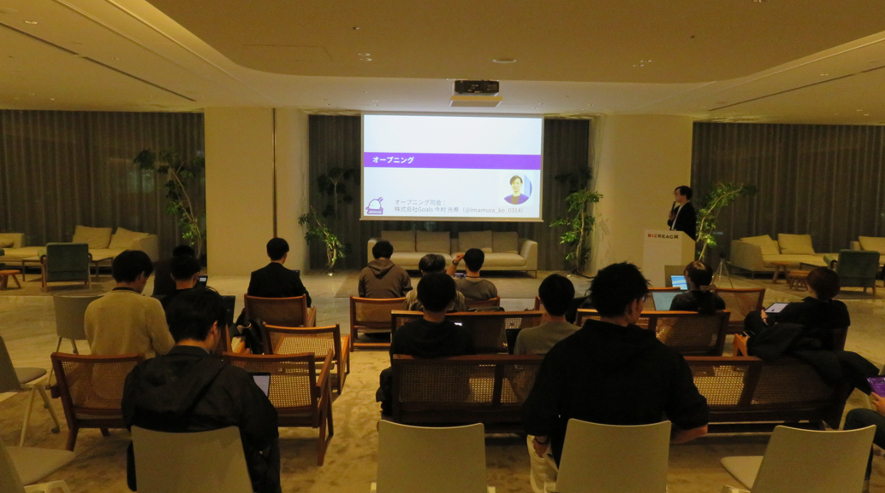

<!-- TODO: 懇親・交流の様子や今後の展望を追記 -->

今回のJDDUG Tokyoでは、
- ガバナンス
- セキュリティ
- Workflow Automation
- User Experience Monitoring
など多様なテーマが共有されました。
共通していたのは、Datadogを単なる監視ツールではなく、運用課題を解決するプラットフォームとして活用していたことです。
運営・登壇者・参加者の皆さま、ありがとうございました。

[connpass 募集案内 JDDUG #24@東京](https://datadog-jp.connpass.com/event/410218/)

